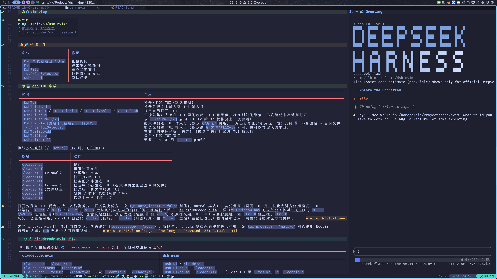

# dsh.nvim

_Bring the [DeepSeek Harness](https://github.com/deepseek-ai/deepseek-harness) (`dsh`) coding agent into your editor_

[](https://neovim.io)
[](./LICENSE)
[](https://github.com/AlbinZhu/dsh.nvim)

<div align="center">

**English** · [简体中文](./README.zh-CN.md)

</div>

## 📸 Screenshot

<p align="center">
  
</p>

`dsh.nvim` is a lightweight Neovim plugin that brings `dsh` into the editor, supporting two ways of working:

- **One-shot task mode** (`headless` profile): ask a question, review the current file, or send a visual selection to the AI agent from a floating window — the result is rendered directly in the float.
- **Interactive terminal TUI**: run [dsh-TUI](https://github.com/ccch1mneyyy/dsh-TUI) (`dsh --profile dsh-tui`) inside a Neovim built-in `:terminal`, with `float` / `split` / `vsplit` / `tab` layouts and one-key toggle.

## ✨ Features

- 🪟 **Floating window interaction** — ask and read the result in one float; close with `q` / `<Esc>`
- 💬 **Three entry points** — ask directly, review the current file, or process a visual selection
- 🖥️ **dsh-TUI integration** — run the interactive TUI in a built-in `:terminal`, four layouts + toggle
- ⚡ **Works out of the box** — auto-detects the `dsh` binary (`PATH` → newest copy under `~/.npm/_npx`)
- 🧩 **Fully customizable** — prompt templates, working directory, timeout, window style, keymaps
- 🔌 **Lua API** — callable from other plugins or your config
- 🔧 **Neovim ≥ 0.10** — built on `vim.system` / `vim.fs`

## 📋 Requirements

- Neovim ≥ 0.10
- The `dsh` CLI from [DeepSeek Harness](https://github.com/deepseek-ai/deepseek-harness) (`@deepseek-ai/dsh`)

Install `dsh` by following [deepseek-harness](https://github.com/deepseek-ai/deepseek-harness), or just let the plugin auto-detect the copy under `~/.npm/_npx`.

To use the TUI, you also need to install [dsh-TUI](https://github.com/ccch1mneyyy/dsh-TUI) into the `dsh-tui` profile (Node `^22.19 || >=24`, `pnpm` on `PATH`):

```sh
npx -y @deepseek-ai/dsh plugin --profile dsh-tui add @deepseek-harness-tui/dsh-tui
```

You can also run `:DshTuiInstall` inside Neovim to do the same. If you already installed dsh-TUI by [its own instructions](https://github.com/ccch1mneyyy/dsh-TUI#command-line-installation), you're set: `dsh-tui` and `dsh --profile dsh-tui` are equivalent.

## 📦 Installation

### [lazy.nvim](https://github.com/folke/lazy.nvim)

```lua
{
  "AlbinZhu/dsh.nvim",
  lazy = false, -- tiny plugin; load it at startup
  config = function()
    require("dsh").setup()
  end,
}
```

Lazy-load on demand (optional):

```lua
{
  "AlbinZhu/dsh.nvim",
  event = "VeryLazy",
  config = function()
    require("dsh").setup()
  end,
}
```

### [packer.nvim](https://github.com/wbthomason/packer.nvim)

```lua
use({
  "AlbinZhu/dsh.nvim",
  config = function()
    require("dsh").setup()
  end,
})
```

### [vim-plug](https://github.com/junegunn/vim-plug)

```vim
Plug 'AlbinZhu/dsh.nvim'
" then in your config:
" lua require("dsh").setup()
```

## 🚀 Quick Start

| Command | Description |
| --- | --- |
| `:Dsh explain this project to me` | Ask directly |
| `:Dsh` | Ask via an input dialog |
| `:DshFile` | Review the current file |
| `:'<,'>DshSelection` | Send the visual selection |
| `:DshCancel` | Cancel the running job |

### 🖥️ dsh-TUI integration

| Command | Description |
| --- | --- |
| `:DshTui` | Toggle the TUI (default layout) |
| `:DshTui [text]` | Open the TUI and type text into its input line |
| `:DshTuiFloat` / `:DshTuiSplit` / `:DshTuiVSplit` / `:DshTuiTab` | Open the TUI in a specific layout |
| `:DshTuiFocus` | Smart focus: hide the TUI if you are in it, focus it if it is visible, otherwise open it |
| `:DshTuiResume [id]` | Start the TUI with `--resume [id]` (the last session when no id is given) |
| `:DshTuiFile [path] [start] [end]` | Add a file to the TUI input line (an `@"path"` mention by default); `start`/`end` limit it to those lines; `%` works, no path = current file |
| `:'<,'>DshTuiSelection` | Add the selection to the TUI input line (an `@"file"#L12-14` reference by default, or the code itself) |
| `:DshTuiTreeAdd` | In a file explorer, add the file under the cursor (or the selected lines) to the TUI input line |
| `:DshTuiClose` | Close/hide the TUI window |
| `:DshTuiInstall` | Install dsh-TUI into the `dsh-tui` profile |

_Default keymaps (registered in `setup()`, can be disabled):_

| Key | Action |
| --- | --- |
| `<leader>da` | Ask |
| `<leader>df` | Review file |
| `<leader>ds` (visual) | Send selection |
| `<leader>tt` | Toggle TUI |
| `<leader>tf` | Add file to TUI |
| `<leader>ts` (visual) | Add selection to TUI (in a file explorer: the selected files) |
| `<leader>ts` (in a file explorer) | Add the file under the cursor to TUI |
| `<leader>tF` | Focus / hide TUI (smart toggle) |
| `<leader>tr` | Resume the last TUI session |

Opening or focusing the TUI puts you straight into terminal mode, so you can type right away (set `tui.auto_insert = false` to stay in normal mode). Focusing the TUI window again, from any window, enters terminal mode too. Inside the TUI terminal, `<C-h>` / `<C-j>` / `<C-k>` / `<C-l>` move to the window in that direction and leave terminal mode, the same as claudecode.nvim (`tui.window_nav` turns single directions off). `<C-\><C-n>` followed by `q` (`tui.close_key`) also hides the window. Every other key, including `q` and `<Esc>`, goes straight to the TUI, as do the TUI's own shortcuts (e.g. `Ctrl+B` side panel, `Ctrl+R` history). dsh-TUI's own `Ctrl+J` (newline), `Ctrl+K` (delete to end of line) and `Ctrl+L` (redraw) are taken by the window keys while they are on, so turn off the ones you need.

The TUI window uses snacks.nvim's terminal when that plugin is installed (`tui.provider = "auto"`), so your snacks terminal keys apply to it; set `tui.provider = "native"` to always use Neovim's built-in terminal. The `tab` layout always uses the built-in terminal.

#### Coming from claudecode.nvim?

The TUI commands and keymaps are modeled on [coder/claudecode.nvim](https://github.com/coder/claudecode.nvim), so the habits carry over:

| claudecode.nvim | dsh.nvim |
| --- | --- |
| `:ClaudeCode` · `<leader>ac` | `:DshTui` · `<leader>tt` |
| `:ClaudeCodeFocus` · `<leader>af` | `:DshTuiFocus` · `<leader>tF` |
| `:ClaudeCode --resume` · `<leader>ar` (and `--continue` · `<leader>aC`) | `:DshTuiResume` · `<leader>tr` — in dsh-TUI, `--resume`, `-c` and `--continue` all mean "reopen the last session" |
| `:ClaudeCodeAdd %` · `<leader>ab` | `:DshTuiFile` · `<leader>tf` (also takes line numbers, e.g. `:DshTuiFile % 10 20`) |
| `:ClaudeCodeSend` · `<leader>as` (visual) | `:DshTuiSelection` · `<leader>ts` (visual) |
| `:ClaudeCodeTreeAdd` · `<leader>as` (file explorer) | `:DshTuiTreeAdd` · `<leader>ts` (file explorer) |
| `:ClaudeCodeSelectModel` · `<leader>am` | `:DshTui /model` — types `/model` into the input, press Enter; dsh-TUI picks models in-app and has no `--model` flag |
| `Ctrl+h/j/k/l` in the terminal | same keys (`tui.window_nav`) |
| `:ClaudeCodeDiffAccept` / `DiffDeny` · `<leader>aa` / `<leader>ad` | — claudecode.nvim receives diffs over the IDE WebSocket protocol; dsh has no such protocol, so there is nothing to accept or deny |

## ⚙️ Configuration

```lua
require("dsh").setup({
  dsh_cmd = nil,            -- path to the dsh executable; nil = auto-detect (PATH → newest copy in ~/.npm/_npx)
  profile = "headless",     -- dsh profile
  launcher_args = {},       -- extra launcher args, e.g. { "--patch", "/path/x.yml" }
  cwd = "root",             -- working directory: "root" (git root) | "buffer" | "cwd" | absolute path
  timeout_ms = nil,         -- task timeout (ms); nil = no limit
  include_file_content = true,
  max_inline_file_chars = 20000,
  close_key = "q",
  prompts = {
    file = "Please look at file `%s` and give your analysis and improvement suggestions.",
    file_with_content = "Here is the full content of file `%s`:\n\n```\n%s\n```\n\nPlease review the file and give your analysis and improvement suggestions.",
    selection = "Here is a piece of code from `%s`:\n\n```\n%s\n```\n\nPlease review this code and give your analysis and suggestions.",
  },
  keymaps = {
    ask = "<leader>da",
    ask_file = "<leader>df",
    ask_visual = "<leader>ds",
    tui = "<leader>tt",
    tui_file = "<leader>tf",
    tui_visual = "<leader>ts",  -- selected code; in a file explorer: the selected files
    tui_focus = "<leader>tF",   -- smart focus / hide (:DshTuiFocus)
    tui_resume = "<leader>tr",  -- resume the last session (:DshTuiResume)
    tui_tree = "<leader>ts",    -- in a file explorer: add the file under the cursor (normal mode, buffer-local)
  },
  tui = {
    profile = "dsh-tui",        -- profile containing dsh-TUI
    launcher_args = {},         -- extra launcher args, e.g. { "--patch", "/path/x.yml" }
    cwd = "root",               -- working directory: "root" | "buffer" | "cwd" | absolute path
    layout = "vsplit",          -- default layout: "float" | "split" | "vsplit" | "tab"
    close_key = "q",            -- key to close/hide the window in terminal normal mode
    file_mode = "mention",      -- how to add files: "mention" (reference) | "content" (paste full content)
    selection_mode = "mention", -- how to add a selection: "mention" (reference @file#L<start>-<end>; pastes the code when the buffer can't be referenced) | "content" (always paste the code)
    auto_insert = true,         -- enter terminal mode when the TUI window gets focus (false = stay in normal mode)
    provider = "auto",          -- "auto" (snacks.nvim's terminal when installed) | "snacks" | "native" (Neovim's built-in terminal); the tab layout is always native
    window_nav = { h = true, j = true, k = true, l = true }, -- terminal <C-h/j/k/l>: move to that window and leave terminal mode; false = none, or set one direction to false
    float = {
      relative = "editor",
      width = 0.94,             -- fractions are relative to the editor size; integers (character columns) are also accepted
      height = 0.9,
      row = 0.03,
      col = 0.03,
      anchor = "NW",
      border = "rounded",
      title = " dsh-tui ",
      title_pos = "center",
      style = "minimal",
      focusable = true,
    },
    split = { position = "below", size = 0.4 },   -- position: "below" | "above"
    vsplit = { position = "right", size = 0.3 },  -- position: "right" | "left"; size: fraction of the editor width
  },
  window = {
    relative = "editor",
    width = 0.72,           -- fractions are relative to the editor size; integers are also accepted
    height = 0.5,
    row = 0.25,             -- (1 - height) / 2, combined with anchor="NW" to center
    col = 0.14,             -- (1 - width) / 2
    anchor = "NW",
    border = "rounded",
    title = " dsh ",
    title_pos = "center",
    style = "minimal",
    focusable = true,
  },
})
```

- Set any entry in `keymaps` to `nil` / `false` / `""` to disable that mapping.
- Commands still work without calling `setup()` (defaults are used); only keymap registration is skipped.

## 🔌 Lua API

```lua
require("dsh").setup(opts)     -- configure + register keymaps
require("dsh").run(task)       -- run a task
require("dsh").ask(prompt?)    -- ask (opens an input dialog when no argument is given)
require("dsh").ask_file()      -- review the current file
require("dsh").ask_visual()    -- process the visual selection
require("dsh").cancel()        -- cancel the running task
require("dsh").open_tui(opts?) -- open/focus the TUI (opts: { layout, text })
require("dsh").toggle_tui(opts?) -- toggle the TUI
require("dsh").close_tui()     -- close/hide the TUI window
require("dsh").tui_install()   -- install the TUI plugin into the tui profile
require("dsh").tui_add_file(path?) -- add a file to the TUI (defaults to @mention)
require("dsh").tui_add_selection() -- add the visual selection to the TUI (file name + lines, or the code)
require("dsh").tui_paste(text) -- safely paste text using bracketed paste
require("dsh.tui").send(text)  -- send text to the TUI input line
```

## 🧠 How it works

The plugin ultimately runs:

```
dsh --profile headless -- "<task text>"
```

The `headless` mode writes only the last non-empty reply to stdout (exit code `0` on success, `1` on failure), so the float shows a spinner while running and renders the result once done; on error, stderr is shown as well.

The TUI integration runs:

```
dsh --profile dsh-tui
```

and puts that process into a Neovim built-in `:terminal` buffer (dsh-TUI is a full-screen interactive terminal app and cannot be treated like headless stdout collection). The process keeps running in the background while the window is hidden; toggling again reuses the same terminal.

Adding code/files to the TUI goes through the terminal's own input surface:

- A visual selection is added as a **file name + line range** by default (`tui.selection_mode = "mention"`, see below). Where that is not possible — an unnamed or non-file buffer, a file that is not on disk yet, or a buffer with unsaved changes — or with `tui.selection_mode = "content"`, the selected code is pasted wholesale into the input line using **bracketed paste** (`ESC[200~ … ESC[201~`) — multi-line code and escape characters are safe, and nothing gets submitted line by line;
- Files are referenced by default as `@"path"` **@mention**, which dsh-TUI expands into an attachment on submit (file text up to its size cap, images as image blocks). The path is written relative to the TUI's working directory when the file is inside it, and absolute otherwise; set `tui.file_mode = "content"` to paste the full content instead;
- A **line range** uses dsh-TUI's `#L` suffix: `:DshTuiFile lua/foo.lua 12 14` adds `@"lua/foo.lua"#L12-14`. A visual selection is added the same way by default — the input box shows just the file name and line numbers, like claudecode.nvim, instead of the pasted code. dsh-TUI reads the file from disk, which is why a buffer with unsaved changes (or one that is not a regular file on disk) falls back to pasting the code; set `tui.selection_mode = "content"` to always paste;
- In a **file explorer** (nvim-tree, neo-tree, oil.nvim, mini.files, netrw, and snacks explorer / picker lists), `<leader>ts` or `:DshTuiTreeAdd` adds the file or directory under the cursor as an `@"path"` mention. For several at once, select lines in visual mode (neo-tree, oil, mini.files) or mark them first (nvim-tree bookmarks, netrw `mf`, snacks `<Tab>`). Tree adds are always mentions, whatever `file_mode` says.

None of these press Enter — they only fill the input line, so you can keep editing before submitting.

`:DshTuiResume [id]` starts the TUI with `--resume [id]`. The flag only applies when a new process starts: if the TUI is already running (even hidden) it is simply shown, with a hint to use `/resume` inside the TUI.

## ❓ FAQ

**Q: The first run is slow?**
The `headless` profile initializes on first use, so the first run takes a few extra seconds — this is normal.

**Q: "dsh not found"?**
The plugin probes in order: `dsh_cmd` → `PATH` → `~/.npm/_npx/*/node_modules/.bin/dsh`. If none of them work, specify it explicitly:

```lua
require("dsh").setup({ dsh_cmd = "/absolute/path/to/dsh" })
```

**Q: How do I close the result window?**
Press `q`, `<Esc>`, or `<C-c>`.

## 🗺️ Roadmap

- [x] Interactive terminal TUI integration (dsh-TUI)
- [ ] Streaming output (once dsh supports incremental output)
- [ ] Session / multi-turn conversation support (headless side; the TUI already has full session management)
- [ ] Write results into a split / quickfix

## 🤝 Contributing

Issues and PRs are welcome. Please keep the existing code style and make sure `require("dsh")` loads correctly.

## 📄 License

[MIT](./LICENSE) © 2026 AlbinZhu

## 🙏 Acknowledgements

Thanks to the [DeepSeek Harness](https://github.com/deepseek-ai/deepseek-harness) project.
