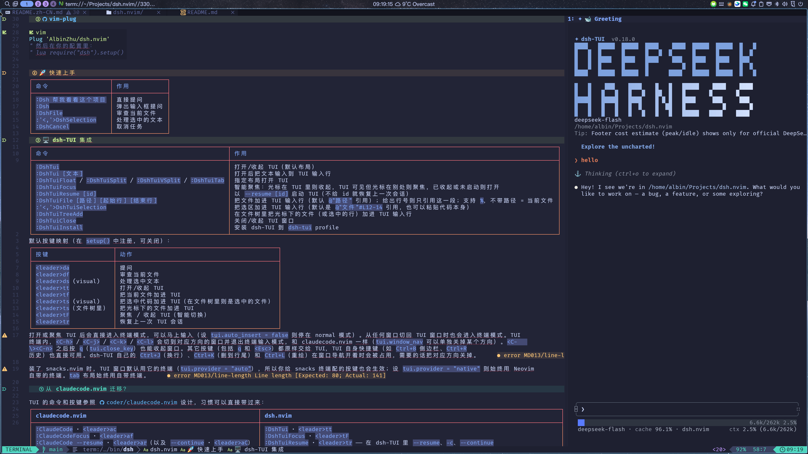

# dsh.nvim

在 Neovim 里直接和 [DeepSeek Harness](https://github.com/deepseek-ai/deepseek-harness)
编码代理对话，不用离开编辑器。

[](https://neovim.io)
[](./LICENSE)
[](https://github.com/AlbinZhu/dsh.nvim)

[**English**](./README.md) · 简体中文

<!-- markdownlint-disable MD033 -->
<p align="center">
  
</p>
<!-- markdownlint-enable MD033 -->

用浮窗快速提问，也可以在分屏里打开完整的交互式 `dsh` 会话。
当前文件和选中的代码，只需一个按键就能带进对话。

## ✨ 为什么用 dsh.nvim

- 🪟 **结果在浮窗里** — 提问、审查当前文件、解释选中的代码，回复直接显示在
  浮窗中。
- 🖥️ **完整的 TUI 就在 Neovim 里** — 交互式的
  [dsh-TUI](https://github.com/ccch1mneyyy/dsh-TUI) 跑在分屏中，支持会话和
  `/resume`。
- 📎 **一个按键带上上下文** — 文件、选区或行区间都能以 `@` 引用的形式加进输入框，
  输入框保持简短。
- ⌨️ **操作习惯一致** — 命令和 `Ctrl+h/j/k/l` 窗口切换与 claudecode.nvim 相同。
- ⚡ **开箱即用** — 自动找到 `PATH` 或 `~/.npm/_npx` 下的 `dsh`。
- 🧩 **可配置** — 提示词、按键、布局、窗口样式，还有 Lua API。

## 🚀 快速上手

先安装 `dsh` 命令行，再添加插件（见下文「安装」）：

```sh
npm install -g @deepseek-ai/dsh
```

然后在 Neovim 里试试：

- `:Dsh 介绍一下这个项目` —— 提问
- `:DshFile` —— 审查当前文件
- `<leader>tt` —— 打开 TUI（第一次先运行一次 `:DshTuiInstall`）

## 📦 安装

### 依赖

- Neovim 0.10 或更新版本
- `dsh` 命令行：`npm install -g @deepseek-ai/dsh`，或者让插件自动找到
  `~/.npm/_npx` 下的副本
- 使用 TUI 还需要 Node.js `^22.19` 或 `>=24`、`pnpm`，以及 dsh-TUI 插件
  （运行 `:DshTuiInstall`）

### [lazy.nvim](https://github.com/folke/lazy.nvim)

```lua
{
  "AlbinZhu/dsh.nvim",
  lazy = false, -- 插件很小，启动时加载，命令随时可用
  config = function()
    require("dsh").setup()
  end,
}
```

### [packer.nvim](https://github.com/wbthomason/packer.nvim)

```lua
use({
  "AlbinZhu/dsh.nvim",
  config = function()
    require("dsh").setup()
  end,
})
```

### [vim-plug](https://github.com/junegunn/vim-plug)

```vim
Plug 'AlbinZhu/dsh.nvim'
" 然后在你的配置里：
" lua require("dsh").setup()
```

## 💬 提问

回复显示在浮窗里，按 `q`、`<Esc>` 或 `<C-c>` 关闭。

| 命令 | 作用 |
| --- | --- |
| `:Dsh <问题>` | 提问（不带参数会弹出输入框） |
| `:DshFile` | 审查当前文件 |
| `:'<,'>DshSelection` | 处理选中的代码 |
| `:DshCancel` | 取消正在运行的任务 |

| 按键 | 动作 |
| --- | --- |
| `<leader>da` | 提问 |
| `<leader>df` | 审查当前文件 |
| `<leader>ds`（visual） | 处理选中的代码 |

## 🖥️ 使用 TUI

交互式 dsh-TUI 跑在 Neovim 终端里，默认是竖分屏，也可以用横分屏、浮窗或标签页。

| 命令 | 作用 |
| --- | --- |
| `:DshTui [文本]` | 打开/收起 TUI，文本会输入到输入框 |
| `:DshTuiFocus` | 聚焦 TUI；光标已经在里面就收起 |
| `:DshTuiFloat` / `Split` / `VSplit` / `Tab` | 用指定布局打开 |
| `:DshTuiResume [id]` | 恢复上一次会话，或指定的会话 |
| `:DshTuiFile [路径] [起始行] [结束行]` | 加进一个文件，或其中的几行 |
| `:'<,'>DshTuiSelection` | 把选中的内容加进输入框 |
| `:DshTuiTreeAdd` | 在文件树里加进光标下的文件 |
| `:DshTuiClose` | 收起 TUI，进程继续运行 |
| `:DshTuiInstall` | 把 dsh-TUI 安装到 `dsh-tui` profile |

| 按键 | 动作 |
| --- | --- |
| `<leader>tt` | 打开/收起 TUI |
| `<leader>tF` | 聚焦 TUI，或收起 |
| `<leader>tr` | 恢复上一次会话 |
| `<leader>tf` | 加进当前文件 |
| `<leader>ts`（visual） | 加进选中的内容 |
| `<leader>ts`（文件树里） | 加进光标下的文件 |

### 使用 TUI 的要点

- **输入** —— 打开或聚焦 TUI 后直接进入终端输入模式，可以马上打字。从其他窗口
  切回来也一样。
- **切换窗口** —— `<C-h>` `<C-j>` `<C-k>` `<C-l>` 切到对应方向的窗口，并退出终端
  输入模式，和 claudecode.nvim 一样。`<C-\><C-n>` 之后按 `q` 可以收起窗口。
- **其它按键** 都交给 TUI，包括 `q`、`<Esc>`、`Ctrl+B`、`Ctrl+R` 等。
- **退出** —— 1 秒内连按两次 `Ctrl+C`。
- **上下文** —— 选区和文件默认以 `@"lua/foo.lua"#L12-14` 的引用形式加入，路径相对
  于 TUI 的工作目录。选中的内容如果来自有未保存修改的缓冲区，会改为粘贴代码，因为
  dsh-TUI 是从磁盘读文件的。
- **终端** —— 装了 snacks.nvim 时，TUI 使用它的终端，你为 snacks 终端配的按键也会
  生效。设 `tui.provider = "native"` 则始终用 Neovim 自带的终端。

## ⚙️ 配置

不配置也能直接用。要改的话：

```lua
require("dsh").setup({
  tui = { layout = "split" },
})
```

常用选项：

| 选项 | 默认值 | 说明 |
| --- | --- | --- |
| `profile` | `"headless"` | 一次性任务使用的 dsh profile |
| `cwd` | `"root"` | `"root"`（git 根目录）、`"buffer"`、`"cwd"` 或路径 |
| `timeout_ms` | `nil` | 任务超时（毫秒），`nil` 表示不限 |
| `tui.layout` | `"vsplit"` | `"float"`、`"split"`、`"vsplit"` 或 `"tab"` |
| `tui.vsplit.size` | `0.3` | 竖分屏宽度，占编辑器宽度的比例 |
| `tui.provider` | `"auto"` | 装了 snacks 就用它，否则用 `"native"` |
| `tui.file_mode` | `"mention"` | `"mention"` 或 `"content"` |
| `tui.selection_mode` | `"mention"` | `"mention"` 或 `"content"` |
| `tui.auto_insert` | `true` | 聚焦 TUI 时自动进入终端输入模式 |
| `tui.window_nav` | 四个方向都是 `true` | Ctrl+hjkl；某个方向设 `false` 即释放 |

`file_mode` 和 `selection_mode` 取 `"mention"` 时以 `@` 引用文件，取 `"content"` 时
直接粘贴内容。完整说明见 `:help dsh`。

### 避免按键冲突

有些默认按键可能和其它插件冲突，比如 LazyVim 用 `<leader>d` 和 `<leader>t`
这两组。可以挪到你自己的前缀下：

```lua
require("dsh").setup({
  keymaps = {
    ask = "<leader>Aa",
    ask_file = "<leader>Af",
    ask_visual = "<leader>As",
    tui = "<leader>At",
    tui_file = "<leader>AF",
    tui_visual = "<leader>AS",
  },
})
```

在 `keymaps` 里把某一项设为 `false` 即可禁用它。

## 🔌 Lua API

```lua
local dsh = require("dsh")

dsh.setup({ tui = { layout = "split" } }) -- 配置并注册按键
dsh.run("介绍一下这个项目")               -- 运行一次性任务
dsh.ask()                                 -- 提问；不带参数时弹出输入框
dsh.ask_file()                            -- 审查当前文件
dsh.ask_visual()                          -- 处理选区
dsh.cancel()                              -- 取消正在运行的任务
dsh.open_tui({ layout = "float", text = "hi" }) -- 打开或聚焦 TUI
dsh.toggle_tui()                          -- 显示或隐藏 TUI
dsh.focus_tui()                           -- 聚焦 TUI；已在里面则收起
dsh.resume_tui("session-id")              -- 以 --resume 启动（nil = 上一次）
dsh.close_tui()                           -- 隐藏 TUI 窗口
dsh.tui_install()                         -- 安装 dsh-TUI
dsh.tui_add_file("lua/foo.lua", 12, 14)   -- 一个文件，可只取其中几行
dsh.tui_add_files({ "lua", "README.md" }) -- 多个文件或目录
dsh.tui_add_tree()                        -- 文件树：加进光标下的文件
dsh.tui_add_selection()                   -- 加进可视选区
dsh.tui_paste("text")                     -- bracketed paste，不会回车
require("dsh.tui").send("text")           -- 向 TUI 输入框输入文本
```

## 🔀 从 claudecode.nvim 迁移

命令和窗口按键与 claudecode.nvim 保持一致，习惯可以直接带过来。

| claudecode.nvim | dsh.nvim |
| --- | --- |
| `:ClaudeCode` · `<leader>ac` | `:DshTui` · `<leader>tt` |
| `:ClaudeCodeFocus` · `<leader>af` | `:DshTuiFocus` · `<leader>tF` |
| `:ClaudeCode --resume` · `<leader>ar` | `:DshTuiResume` · `<leader>tr` |
| `:ClaudeCodeAdd %` · `<leader>ab` | `:DshTuiFile` · `<leader>tf` |
| `:ClaudeCodeSend` · `<leader>as` | `:DshTuiSelection` · `<leader>ts` |
| `:ClaudeCodeTreeAdd` · `<leader>as` | `:DshTuiTreeAdd` · `<leader>ts` |
| 终端里的 `Ctrl+h/j/k/l` | 同样的按键 |
| `:ClaudeCodeSelectModel` · `<leader>am` | `:DshTui`，然后输入 `/model` |
| `:ClaudeCodeDiffAccept` / `Deny` | 无对应功能：dsh 没有 IDE 的 diff 协议 |

## 🧠 工作原理

- **快速提问**执行 `dsh --profile headless -- "<任务>"`，把最后一条回复显示在
  浮窗中，运行期间显示 spinner。
- **TUI** 在 `:terminal` 缓冲区里执行 `dsh --profile dsh-tui`。收起窗口时进程继续
  运行，再次打开会回到同一个会话。
- **上下文**输入到 TUI 的输入框，不会替你提交。

## ❓ 常见问题

### 第一次运行很慢

`headless` profile 首次使用时会自动初始化，属正常现象。

### 找不到 `dsh`

插件依次检查 `dsh_cmd`、`PATH`、`~/.npm/_npx`。也可以显式指定：

```lua
require("dsh").setup({ dsh_cmd = "/path/to/dsh" })
```

### TUI 提示缺少 profile 或插件

运行一次 `:DshTuiInstall`。

### 怎样退出 TUI 里的输入模式

用 `<C-h>` `<C-j>` `<C-k>` `<C-l>` 切到其它窗口，或者按 `<C-\><C-n>`。

### `Ctrl+J`、`Ctrl+K`、`Ctrl+L` 没有反应

这些键被窗口导航占用了。dsh-TUI 用它们做换行、删到行尾和重绘。需要哪个就释放哪个，
例如：

```lua
require("dsh").setup({ tui = { window_nav = { j = false } } })
```

## 🤝 贡献

欢迎提 issue 和 PR。请保持现有代码风格，并确认插件仍能加载：

```sh
nvim --headless -u NONE --cmd 'set rtp+=.' -c 'lua require("dsh")' -c 'qa!'
```

## 📄 许可证

[MIT](./LICENSE) © 2026 AlbinZhu

## 🙏 致谢

感谢 [DeepSeek Harness](https://github.com/deepseek-ai/deepseek-harness) 项目。
